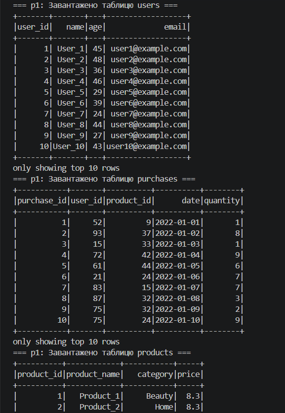
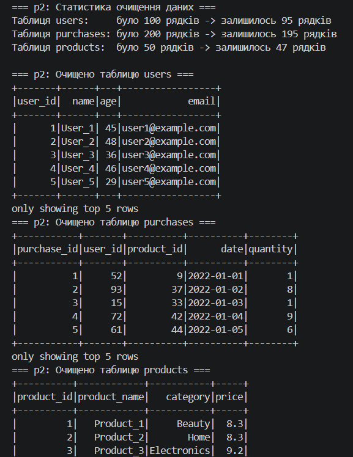
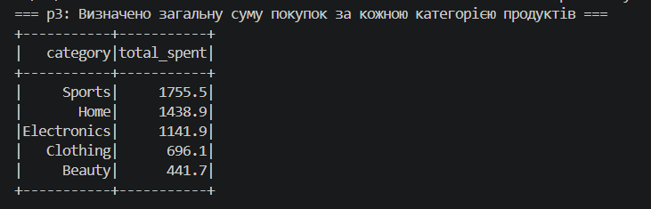
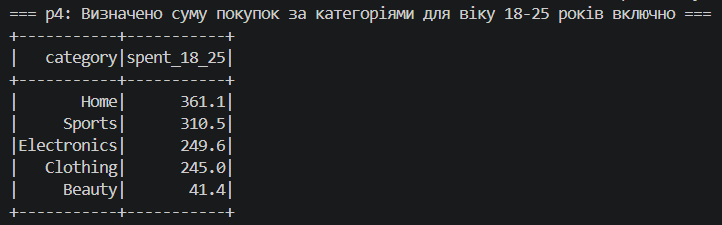
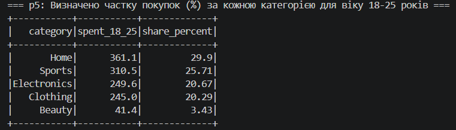
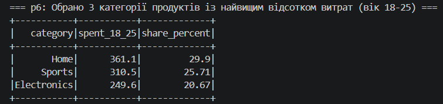

# Домашнє завдання №3. Аналіз даних у PySpark

Виконано обробку та аналіз транзакційних даних за допомогою **Apache Spark (PySpark)** на основі вхідних файлів `users.csv`, `purchases.csv` та `products.csv`. Для кожного етапу розроблено окремий скрипт (`p1.py` – `p6.py`).

## Результати виконання

### 1. Завантаження та читання даних (`p1.py`)
Ініціалізовано сесію `SparkSession` та зчитано три CSV-файли в окремі DataFrame з автоматичним визначенням схеми (`header=True`, `inferSchema=True`).

### 2. Очищення даних (`p2.py`)
З кожного DataFrame видалено рядки з пропущеними значеннями за допомогою `.dropna()`. Кількість записів після очищення змінилася наступним чином: `users` (зі 100 до 95), `purchases` (з 200 до 195), `products` (з 50 до 47).

### 3. Загальна сума покупок за категоріями (`p3.py`)
Очищені таблиці об'єднано за ключами `user_id` та `product_id`. Обчислено сумарні витрати (`quantity * price`) у розрізі кожної категорії:

| Категорія | Загальна сума |
| :--- | :---: |
| Sports | 1755.5 |
| Home | 1438.9 |
| Electronics | 1141.9 |
| Clothing | 696.1 |
| Beauty | 441.7 |

### 4. Сума покупок для вікової категорії 18–25 років (`p4.py`)
Відфільтровано транзакції користувачів віком від 18 до 25 років включно та підраховано суму витрат за категоріями (загальна сума у групі склала `1207.6`):

| Категорія | Сума (18–25 років) |
| :--- | :---: |
| Home | 361.1 |
| Sports | 310.5 |
| Electronics | 249.6 |
| Clothing | 245.0 |
| Beauty | 41.4 |

### 5. Частка покупок за категоріями для віку 18–25 років (`p5.py`)
За допомогою віконної функції `Window.partitionBy()` визначено відсоткову частку кожної категорії від загальних витрат молодіжного сегмента з округленням до двох знаків після коми:

| Категорія | Сума (18–25 років) | Частка (%) |
| :--- | :---: | :---: |
| Home | 361.1 | 29.90 |
| Sports | 310.5 | 25.71 |
| Electronics | 249.6 | 20.67 |
| Clothing | 245.0 | 20.29 |
| Beauty | 41.4 | 3.43 |

### 6. Топ-3 категорії за відсотком витрат віком 18–25 років (`p6.py`)
Відсортовано категорії за спаданням частки витрат та обрано три лідери: **Home** (29.90%), **Sports** (25.71%) та **Electronics** (20.67%).

## Висновки

За результатами аналізу встановлено, що серед усіх вікових груп найбільший виторг генерують категорії Sports (1755.5) та Home (1438.9), проте у віковому сегменті 18–25 років структура попиту змінюється і на перше місце виходить категорія Home із часткою 29.90% (361.1). Три провідні категорії серед молоді — Home, Sports (25.71%) та Electronics (20.67%).